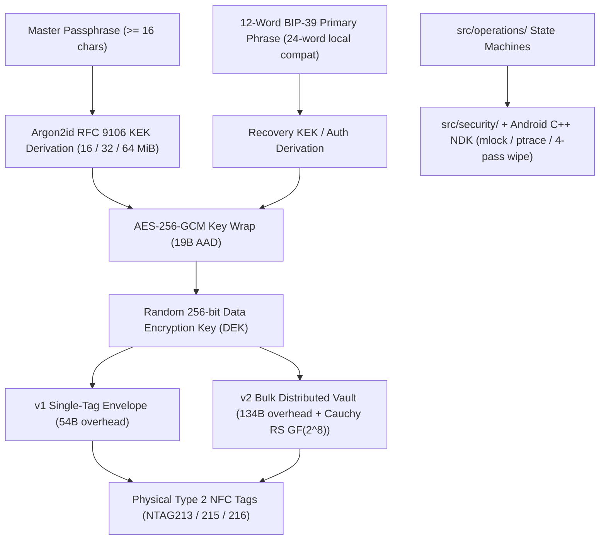
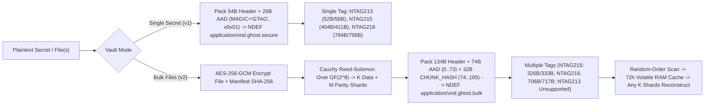
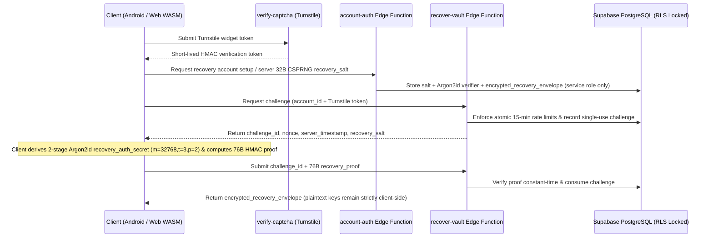

# Ghost-Tag (`v2.1.0` Staging)

> **Zero-knowledge, local-first NFC encryption across physical NTAG213, NTAG215, and NTAG216 tags — backed by Argon2id, AES-256-GCM, Cauchy Reed-Solomon over $\mathrm{GF}(2^8)$, native C++17 memory defense, and authenticated local desktop PC/SC + PN532 hardware bridges.**

> **Release Status Honesty Notice**: Latest published GitHub Release is **`v2.0.6`**. Version **`2.1.0`** is unreleased staging software whose source/CI hardening is verified, while physical NFC handset validation, physical ACR122U / ESP32-PN532 validation, live Supabase Edge Function deployment, npm publishing, and `v2.1.0` release tagging remain **pending**. See [`PROJECT-STATUS.md`](PROJECT-STATUS.md) and [`FAQ.md`](FAQ.md).

---

## Table of Contents
1. [Core Capabilities](#core-capabilities)
2. [Architecture & Binary Diagrams](#architecture--binary-diagrams)
3. [Cryptographic Primitives & Key Hierarchy](#cryptographic-primitives--key-hierarchy)
4. [Binary Envelope Formats & NTAG21x Capacities](#binary-envelope-formats--ntag21x-capacities)
5. [Cross-Platform Clients & Hardware Policy](#cross-platform-clients--hardware-policy)
6. [Cloud Metadata & v2.1.0 Challenge-Proof Recovery](#cloud-metadata--v210-challenge-proof-recovery)
7. [Repository Map (All 11 Documented Folders)](#repository-map-all-11-documented-folders)
8. [Verification, Tests & Coverage](#verification-tests--coverage)
9. [Pull Request & Security Status](#pull-request--security-status)
10. [Quick Links & Governance](#quick-links--governance)

---

## Core Capabilities
- **Single-Tag Encrypted Vault (`v1`)**: Encrypts sensitive text/config/asset fragments using a compact **54-byte** Little-Endian binary envelope (`GTAG`, `0x01`, `26B` AAD) over `application/vnd.ghost.secure`. Fits `NTAG213`, `NTAG215`, and `NTAG216`.
- **Distributed Bulk Vaults (`v2`)**: Splits arbitrary encrypted files across sets of `NTAG215` / `NTAG216` tags using **134-byte** Little-Endian envelopes (`GTAG`, `0x02`, `RECORD_TYPE = 0x10`, `74B` AAD, full `32B` SHA-256 `CHUNK_HASH`) over `application/vnd.ghost.bulk`, protected by systematic **Cauchy-Vandermonde Reed-Solomon** parity shards over $\mathrm{GF}(2^8)$ (`0x11d`) and volatile **72-hour RAM cache** (`ChunkCacheManager`) for random-order scanning.
- **Native Android Hardening**: `MainActivity.kt` enforces `FLAG_SECURE`; `KeyStoreMasterKey.kt` anchors hardware TEE/StrongBox wrapping; `android/app/src/main/cpp/` implements `ptrace` anti-debug, `/proc/self/maps` hook detection, root checks, `mlock()` page locking, and 4-pass volatile zeroization with compiler memory barriers.
- **Zero Synthetic Data**: `Ghost Bridge` (`127.0.0.1:41789`), Web Companion, and React Native screens strictly refuse synthetic/simulated NFC events (`simulate_tag` returns an error) and bind hardware actions to per-connection CSPRNG `sessionToken` (`timingSafeEqual`).
- **Two-Stage Zero-Knowledge Cloud Recovery (`v2.1.0`)**: Opt-in Supabase recovery uses Cloudflare Turnstile (`verify-captcha`), server-generated 32-byte CSPRNG `recovery_salt` (`account-auth`), two-stage Argon2id (`m=32768, t=3, p=2, h=32, v=0x13`), and interactive `76B` HMAC challenge/proof verification (`recover-vault`) with locked-down RLS (`ghost_vaults` revoked from direct client access).

---

## Architecture & Binary Diagrams

### 1. Subsystem Architecture & Two-Tier Key Hierarchy

### 2. Single-Tag v1 vs Bulk Distributed v2 NDEF Pipeline

### 3. Opt-In v2.1.0 Turnstile & Challenge-Response Cloud Recovery

---

## Cryptographic Primitives & Key Hierarchy
- **Symmetric AEAD**: AES-256-GCM with 12-byte (96-bit) CSPRNG nonces and 16-byte (128-bit) constant-time tags (`src/crypto/aesGcm.ts`).
- **Primary KDF Profiles (`DEFAULT_KDF_PARAMETERS_BY_TIER` in `src/contracts/keyHierarchy.ts`)**:
  - `LOW_END`: `16,384 KiB` (`16 MiB`), `t = 2`, `p = 1`, `v = 0x13`
  - `STANDARD` (default): `32,768 KiB` (`32 MiB`), `t = 3`, `p = 2`, `v = 0x13`
  - `HIGH_END`: `65,536 KiB` (`64 MiB`), `t = 4`, `p = 4`, `v = 0x13`
  - All primary KDF salts: `16 bytes` CSPRNG.
- **Recovery Derivation**:
  - Primary recovery phrase: **12-word BIP-39 English mnemonic** (`128` entropy + `4` checksum bits). Local `RecoveryManager` retains `24-word` local unwrapping compatibility.
  - Local `DEFAULT_RECOVERY_KDF_CONFIG`: `65,536 KiB`, `t = 5`, `p = 4`, `32B` salt.
  - Cross-platform v2.1.0 cloud recovery (`hash-wasm` WASM on Web / Edge Functions): `32,768 KiB` (`32 MiB`), `t = 3`, `p = 2`, `h = 32B`, `v = 0x13` over server-generated `32B` CSPRNG `recovery_salt`.
- **Memory & Log Hygiene**: 4-pass overwrite (`0xAA`, `0x55`, CSPRNG, `0x00` + C++ compiler barrier), constant-time `timingSafeEqual`, and log redaction (`SanitizedLogger`).

---

## 7. Cross-Platform Compatibility Matrix

| Feature / Capability | Android APK (Primary) | Web Companion (Chrome Android) | Desktop Ghost Bridge | iOS Foundation | iOS Native (new) |
| :--- | :---: | :---: | :---: | :---: | :---: |
| **NDEF Reading** | Yes (Native)* | Yes (Web NFC)* | Yes (ACR122U / PN532)* | CoreNFC Code Only* | Yes (CoreNFC) |
| **NDEF Writing** | Yes (Native)* | Yes (Web NFC)* | Yes (ACR122U / PN532)* | No (Strictly Read-Only) | Read-only |
| **AES-256-GCM Encryption** | Yes (256-bit) | Yes (WebCrypto) | Yes (Node.js Crypto) | Yes (CryptoKit) | Yes |
| **BIP-39 12-Word Recovery** | Yes (Canonical) | Yes (Canonical) | Yes (Canonical) | Yes (Canonical) | Yes |
| **Single-Tag Vault (v1)** | Yes (54B Overhead) | Yes (54B Overhead) | Yes (54B Overhead) | Model Implemented | Read-only (CoreNFC) |
| **Bulk Multi-Tag Vault (v2)**| Yes (134B Overhead) | Yes (134B Overhead) | Yes (134B Overhead) | Model Implemented | Read-only (CoreNFC) |
| **Scanned Chunk Cache** | Volatile RAM Only | Volatile RAM Only | Volatile RAM Only | N/A | N/A |

> \* **Hardware & Cloud Status Disclosure**:
> - **Release Status**: Ghost-Tag v2.1.0 is an unreleased local staging version.
> - **iOS**: Ghost-Tag on iOS does not currently implement NFC tag writing. Its CoreNFC integration is read-only. iOS tag-writing support, if added in the future, would require separate implementation, entitlement review, compatibility testing, and physical-device validation.
> - **Supabase Cloud**: Supabase Cloud: Undeployed. Schema and atomic migration RPC are implemented and covered by local tests, but have not been deployed to a live Supabase project or validated against a live database.
> - **Hardware Validation**: Android NFC, iOS CoreNFC, Ghost Bridge ACR122U, and PN532 transceivers are implemented in source code and verified via unit tests; real-device physical execution remains unverified pending attached hardware.
> - **Pull Requests**: PR #24 (perf optimizations, merged) and PR #25 (iOS support) — see [`docs/wiki/Roadmap.md`](docs/wiki/Roadmap.md).

| **Stop & Pause Controls** | Yes | Yes | Yes | N/A | Yes |
| **Opt-in Cloud Metadata** | Optional | Optional | Optional | Client Implemented | Client Implemented |

---

## Binary Envelope Formats & NTAG21x Capacities

All envelopes begin with 4-byte ASCII magic `"GTAG"` (`0x47, 0x54, 0x41, 0x47`) and Little-Endian integers:
- **v1 (`application/vnd.ghost.secure`)**: `54 bytes` fixed overhead (`26B` AAD + `12B` nonce + `16B` GCM tag).
- **v2 (`application/vnd.ghost.bulk`)**: `134 bytes` fixed overhead (`74B` AAD across offsets `0..73` + `32B` SHA-256 `CHUNK_HASH` across `74..105` + `12B` nonce + `16B` GCM tag). There is no Merkle tree.

| Tag IC | Total / User EEPROM | v1 Single-Tag Max Ciphertext (`TagInfo.ts` / `apdu.js`) | v2 Bulk Chunk Max Ciphertext (`TagInfo.ts` / `apdu.js`) | Notes |
| :--- | :--- | :--- | :--- | :--- |
| **NTAG213** | `180B` / `144B` | `52B` / `56B` | **Does Not Fit (`0B`)** | Insufficient framed capacity for `134B` v2 bulk header + NDEF MIME framing (`fits: false`). |
| **NTAG215** | `540B` / `504B` | `404B` / `411B` | `326B` / `333B` | Recommended baseline tag for v2 distributed vaults. |
| **NTAG216** | `924B` / `888B` | `784B` / `795B` | `706B` / `717B` | High-capacity tag minimizing tag count in bulk vaults. |

---

## Cross-Platform Clients & Hardware Policy

| Surface | Path | Current Verification Status |
| :--- | :--- | :--- |
| **Android App** | [`android/`](android/README.md) | Gradle compiles (`BUILD SUCCESSFUL`; `:app:testDebugUnitTest NO-SOURCE`); emulator launch clean (`Medium_Phone_API_37.0`); **physical handset NFC pending**. |
| **Web Companion** | [`web/`](web/README.md) | Vite (`6.4.6`) production build & `0`-vuln audit pass; Chromium SPA showcase verified; Android Chrome physical Web NFC pending. |
| **Desktop Ghost Bridge** | [`desktop/`](desktop/README.md) | Standalone + Jest HTTP/WS `sessionToken`/origin tests & `22` PN532 serial tests pass; **physical ACR122U & ESP32/PN532 hardware pending**. |
| **iOS Foundation** | [`ios/`](ios/README.md) | `MARKETING_VERSION = 2.1.0` (`CURRENT_PROJECT_VERSION = 7`); PR `#25` CoreNFC deferred to `iOS Beta` (macOS + physical iPhone required). |

---

## Cloud Metadata & v2.1.0 Challenge-Proof Recovery
- Opt-in schema in [`supabase/`](supabase/README.md) introduces `user_accounts`, `vault_metadata`, `recovery_challenges`, and `ghost_vault_status` view, revoking direct client access to `ghost_vaults` and sensitive recovery columns.
- Legacy deterministic `Option A` test fixtures remain in [`test-fixtures/`](test-fixtures/README.md) exclusively for deterministic vector regression tests (`crossPlatformCryptoCompatibility.test.ts`).
- Live cloud project deployment has **not** yet been executed; Supabase policies and Edge Function handlers are verified via mocked policy/security Jest suites.

---

## Repository Map (All 11 Documented Folders)

| Directory | Documentation | Contents |
| :--- | :--- | :--- |
| Root `/` | [`README.md`](README.md) & [`FAQ.md`](FAQ.md) | Repository portal, canonical overview, and 70-question cited FAQ |
| `src/` | [`src/README.md`](src/README.md) | Shared TypeScript core, contracts, crypto, NFC, ops, security, vault, cloud, React Native UI |
| `android/` | [`android/README.md`](android/README.md) | Kotlin security modules, C++17 NDK core, Gradle build, adaptive branding |
| `desktop/` | [`desktop/README.md`](desktop/README.md) | Ghost Bridge WS/HTTP PC/SC server (`127.0.0.1:41789`), APDU framing, PN532/ESP32 firmware |
| `web/` | [`web/README.md`](web/README.md) | Vite MPA web showcase, WASM Argon2id, Turnstile, Web NFC + Ghost Bridge client |
| `supabase/` | [`supabase/README.md`](supabase/README.md) | PostgreSQL migrations, RLS hardening, and Edge Functions (`verify-captcha`, `account-auth`, `recover-vault`, `sync-metadata`) |
| `ios/` | [`ios/README.md`](ios/README.md) | Swift cryptographic foundation and deferred PR `#25` CoreNFC roadmap |
| `scripts/` | [`scripts/README.md`](scripts/README.md) | CI security/quality agents, APK packaging (env-var signed), branding asset generators |
| `tests/` | [`tests/README.md`](tests/README.md) | Static unused-code scanner and Jest test suite inventory |
| `test-fixtures/` | [`test-fixtures/README.md`](test-fixtures/README.md) | Deterministic golden cross-platform crypto reference vectors |
| `docs/` | [`docs/README.md`](docs/README.md) | Engineering specs, ADRs (`0001`–`0004`), security audit log, and 18 wiki chapters |

---

## Verification, Tests & Coverage

- **TypeScript Strict Mode**: `npm run typecheck` and `npx tsc -p tsconfig.build.json --noEmit` — **0 errors**.
- **Lint & Unused Scan**: `npm run lint` (`0` errors) and `node tests/scan-unused.cjs` — **passed**.
- **Default Jest Suite (`npm test -- --ci --maxWorkers=2`)**: **26 test suites / 347 tests passing**.
  - **Measured Coverage (`--coverage`)**: `56.06% Statements` | `46.44% Branches` | `54.67% Functions` | `57.16% Lines`.
- **PN532 Serial Suite (`npx jest desktop/test/pn532_serial.test.js`)**: **1 suite / 22 tests passing** (combined **369 tests across 27 suites**).
- **Web Build & Security Audits**: `npm --prefix web run build` passes; `npm audit --audit-level=moderate` and `npm --prefix web audit --audit-level=moderate` report **0 vulnerabilities**.
- **Audit Agents**: `python scripts/security_audit_agent.py` & `python scripts/quality_audit_agent.py` pass cleanly.

---

## Pull Request & Security Status
- **Merged**: PR `#24` (`bulk-scanning-v2`), PR `#2` (`prettier` `3.10.1`), PR `#34` (CodeQL `#75`/`#76`/`#78` fix, `desktop/**` CodeQL workflow trigger, UI stub elimination, script credential cleanup, Xcode version sync).
- **Deferred (`defer_with_documented_plan`)**: PR `#25` (`ios/ghost-tag-support` -> `iOS Beta`), PR `#21` (`vite` `8.3.8` in `/web` -> `v2.2+`), PR `#9` (`typescript` `7.0.2` -> `v2.2+`).
- **Code Scanning**: Open CodeQL alerts on `desktop/src/server.js` (`#75`, `#76`, and `#78`) were fixed in source without suppression comments.

---

## Quick Links & Governance
- [`FAQ.md`](FAQ.md) — 70 evidence-cited Q&As
- [`PROJECT-STATUS.md`](PROJECT-STATUS.md) — Component verification & release blocker matrix
- [`CHANGELOG.md`](CHANGELOG.md) & [`RELEASE-NOTES.md`](RELEASE-NOTES.md) — Version history & `v2.1.0` staging summary
- [`SECURITY.md`](SECURITY.md) & [`SUPPORT.md`](SUPPORT.md) — Threat disclosure policy & support channels
- [`CONTRIBUTING.md`](CONTRIBUTING.md) & [`CODE_OF_CONDUCT.md`](CODE_OF_CONDUCT.md) — PR workflow & branch protection rules
- [`AGENT.md`](AGENT.md) & [`agents/`](agents/) — Autonomous agent roles and verification contracts
