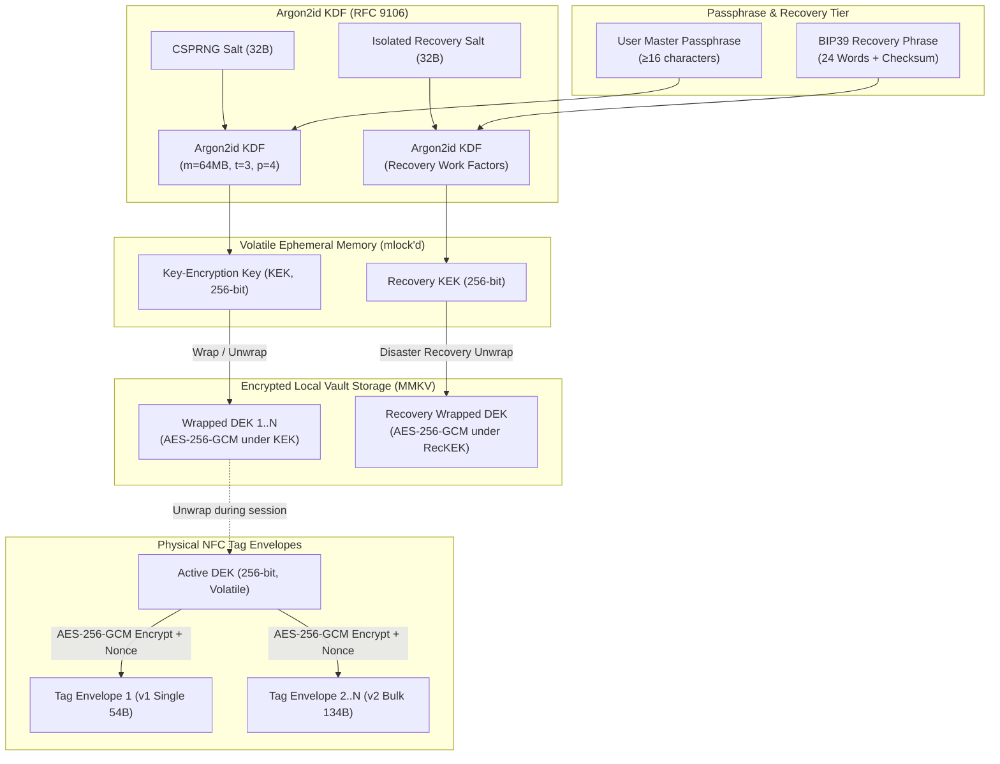
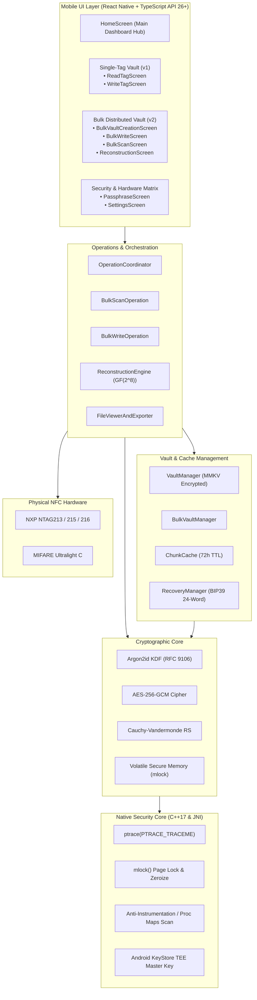
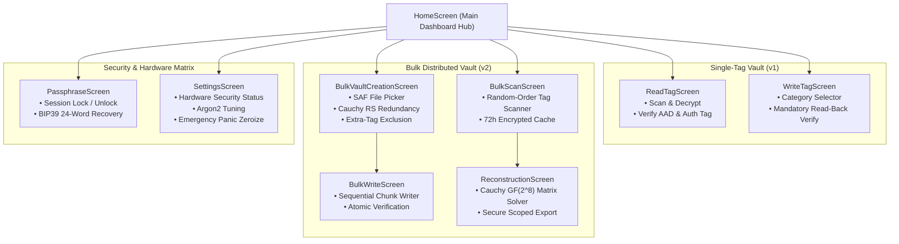
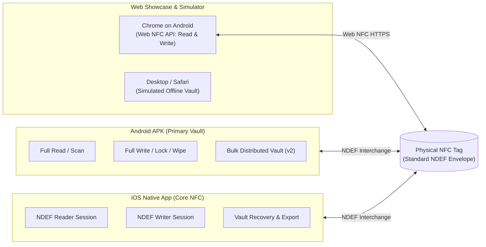

# Ghost-Tag

> **Mobile-first, offline encrypted NFC vault writing versioned AES-256-GCM ciphertext envelopes to narrowly supported NDEF tags, backed by a recoverable Argon2id key hierarchy.**

[](./LICENSE)
[-black.svg)](https://developer.android.com)
[](./docs/cryptography.md)
[-brightgreen.svg)](./src/__tests__/)
[](./scripts/security_audit_agent.py)
[](./scripts/quality_audit_agent.py)
[](./.github/dependabot.yml)
[](https://github.com/FROSTY-MUG/Ghost-Tag/releases/tag/v2.0.0)

---

## 1. Project Thesis

### 1.1 The Core Problem
Ordinary NFC tags are convenient, physical, and ubiquitous—but fundamentally insecure by default:
- Anyone with an NFC-enabled smartphone can read their contents in plaintext.
- Anyone with a generic NFC writer app can overwrite or corrupt them.
- Standard NDEF formatting commands zero out only table-of-contents records, leaving data remanence in EEPROM user pages.
- Losing an NFC tag carrying sensitive recovery seed phrases, Wi-Fi credentials, server keys, or personal notes exposes plaintext to any finder.

### 1.2 Ghost-Tag's Solution
Ghost-Tag provides **data confidentiality and cryptographic tamper-evidence** for payloads stored on physical NFC tags.

The central design principle:
> **The physical NFC tag may be inspected, duplicated, erased, replayed, or lost—yet its protected payload remains computationally unusable without the user's master passphrase and cryptographic key hierarchy.**

### 1.3 What Ghost-Tag IS NOT
To maintain rigorous technical credibility, Ghost-Tag must **never** be described as:
- A replacement for hardware protocol tools like a Proxmark3 or Flipper Zero.
- An NFC cloner, protocol sniffer, or card emulation utility.
- A system that prevents physical tag cloning (if a tag is cloned, the ciphertext is copied too).
- A system that guarantees silicon-level forensic erasure across all flash memory geometries.
- A cloud-backed password manager or public-key infrastructure (PKI) system.
- Secure on a rooted or compromised host operating system observing active process memory.

---

## 2. Security Architecture & Threat Model

Ghost-Tag explicitly defines adversarial boundaries:

```
[Adversary]                     [Capability]                    [Ghost-Tag Guarantee]
Physical Finder of Tag   --->   Reads raw NDEF records    --->  Sees only authenticated ciphertext. Cannot decrypt.
RF Sniffer / Malicious Reader -> Intercepts RF frames     --->  Sees only 12B nonce, 16B keyId, ciphertext.
Tampering Attacker       --->   Alters bytes on tag chip  --->  AES-256-GCM authentication tag fails immediately.
Tag Cloner               --->   Duplicates entire tag     --->  Ciphertext duplicate remains computationally unreadable.
Compromised Host OS      --->   Root keylogger/debugger   --->  Non-goal. Host memory inspection cannot be defeated.
```

### 2.1 Two-Tier Cryptographic Key Hierarchy



- **Zero-Secrets Policy**: Passphrases, derived KEKs, and unwrapped DEKs are **never persisted** to SQLite, MMKV, logs, or crash dumps.
- **In-Memory Hygiene**: Ephemeral keys are overwritten with `0x00` bytes (`zeroize()`) immediately after cryptographic execution.
- **Auto-Lock**: Active sessions lock and purge volatile keys after 5 minutes of inactivity or when the app is backgrounded.

---

## 3. Canonical Binary Envelope Format

Every Ghost-Tag record on an NFC tag is encoded in a fixed-overhead binary format using **Little-Endian (LE)** byte order:

```
Offset   Field Name          Size       Description
─────────────────────────────────────────────────────────────────────────────
00..03   MAGIC               4 bytes    ASCII "GTAG" (0x47, 0x54, 0x41, 0x47)
04       FORMAT_VERSION      1 byte     0x01 (Version 1)
05       PURPOSE             1 byte     0x01=NOTE, 0x02=CREDENTIAL, 0x03=CONFIG, etc.
06..21   KEY_ID              16 bytes   128-bit unique Data Encryption Key ID
22..33   NONCE               12 bytes   96-bit AES-256-GCM IV (never repeated)
34..37   CIPHERTEXT_LENGTH   4 bytes    uint32 Little-Endian length (N)
38..N-1  CIPHERTEXT          N bytes    AES-256-GCM encrypted payload
N..N+15  GCM_TAG             16 bytes   128-bit authentication tag
─────────────────────────────────────────────────────────────────────────────
Total Fixed Overhead: 54 bytes | Payload capacity: Tag Capacity - 54B
```

### Authenticated Associated Data (AAD)
To prevent cross-tag payload transplantation, purpose switching, or truncation attacks, the AES-GCM authentication tag binds 26 bytes of deterministic Additional Authenticated Data:
$$\text{AAD} = \text{"GTAG"} \;||\; \text{FORMAT\_VERSION (1B)} \;||\; \text{PURPOSE (1B)} \;||\; \text{KEY\_ID (16B)} \;||\; \text{CIPHERTEXT\_LENGTH (4B LE)}$$

---

## 4. Supported NFC Hardware Matrix

Ghost-Tag supports standard **NFC Forum Type 2** tags (NXP NTAG21x and MIFARE Ultralight):

| Tag Family | Total Memory | User Memory Pages | Usable Plaintext Capacity | Recommended Purpose |
| :--- | :--- | :--- | :--- | :--- |
| **NTAG213** | 180 Bytes | Pages 4..39 (144B) | **45 Bytes** | Short passwords, tokens |
| **NTAG215** | 540 Bytes | Pages 4..129 (504B) | **404 Bytes** | Recovery notes, Wi-Fi keys, secrets |
| **NTAG216** | 924 Bytes | Pages 4..225 (888B) | **780 Bytes** | Server configs, SSH keys, full notes |
| **MIFARE Ultralight C** | 192 Bytes | Pages 4..39 (144B) | **45 Bytes** | Asset tags, credentials |

> [!IMPORTANT]
> **Page 3 (Capability Container - CC)** and lock bytes are strictly protected during all operations. Destructive overwrites target strictly user memory pages (`Page 4` to `Page N`).

---

## 5. Technology Stack & System Architecture



- **Mobile Framework**: React Native (Android Native Target, API 26+)
- **Language**: TypeScript (Strict Mode)
- **NFC Transceiver**: `react-native-nfc-manager` (Foreground Dispatch & NDEF framing)
- **Cryptographic Primitives**: `react-native-quick-crypto` (OpenSSL-backed CSPRNG & AES-256-GCM)
- **Key Derivation**: `react-native-argon2` (RFC 9106 memory-hard KDF)
- **Encrypted Vault Storage**: `react-native-mmkv` with AES-256 at rest
- **State Management**: `zustand`
- **Navigation**: React Navigation Native Stack

---

## 6. Single-Tag Cryptographic Workflows (v1)

### 6.1 Scan & Decrypt
1. Hold tag to back of phone.
2. Android foreground dispatch delivers tag intent.
3. Envelope is parsed and validated for `GTAG` magic and version `0x01`.
4. Key ID is resolved from the local vault; prompts for master passphrase if locked.
5. DEK is unwrapped in volatile memory $\rightarrow$ AES-256-GCM decrypts payload $\rightarrow$ Plaintext rendered to secure terminal display.
6. Ephemeral DEK buffer is immediately zeroized.

### 6.2 Write & Mandatory Read-Back Verification
1. User enters payload and selects categorical purpose.
2. App validates that payload length fits available tag space after deducting 54 bytes overhead.
3. AES-256-GCM encrypts payload with a fresh 12-byte CSPRNG nonce.
4. Serialized binary envelope is written via NDEF.
5. **Mandatory Read-Back**: App re-reads the entire envelope from the physical tag and verifies byte-for-byte matching of key ID, nonce, ciphertext, and GCM tag.
6. Only upon matching is `WRITE_VERIFIED` displayed.

### 6.3 Destructive Tag Overwrite (Wipe)
1. User confirms destructive wipe after reading the honesty disclaimer.
2. App writes all user memory pages (`Pages 4 .. N`) with `0x00` zeros (Pass 1).
3. App overwrites all user memory pages with CSPRNG random bytes (Pass 2).
4. Memory is read back to confirm overwrite.
5. Blank NDEF container (`0x03 0x00 0xFE`) is restored. If interrupted, `WIPE_PARTIAL` is flagged.

### 6.4 Disaster Recovery
1. User installs Ghost-Tag on a new device.
2. Enters their 24-word BIP39 mnemonic recovery phrase.
3. Recovery KEK is derived via Argon2id with dedicated recovery work factors.
4. All DEKs are recovered, user sets a new master passphrase, and vault access is restored.

---

## 7. Android App Screens & User Workflows

The Ghost-Tag Android application provides a comprehensive suite of offline, hardware-anchored screens:



### 7.1 Single-Tag Vault Screens
- **Read & Decrypt Tag (`ReadTagScreen`)**: Connects to the device's NFC controller to poll for Ghost-Tag Type 2 tags. Validates the 4-byte `GTAG` magic, parses the 54-byte envelope, derives ephemeral KEK via Argon2id, verifies AAD and AES-256-GCM authentication tag, and displays decrypted plaintext with one-touch clipboard copy and diagnostic log stream.
- **Write & Lock Tag (`WriteTagScreen`)**: User selects categorical purpose (`0x01` Note, `0x02` Credential, `0x03` Config, `0x05` Asset ID), enters secret plaintext, and picks target hardware chip (NTAG213, NTAG215, NTAG216). Displays real-time capacity utilization bar, validates $\ge 16$-character passphrase, derives KEK, binds deterministic AAD, writes envelope to EEPROM, and performs read-back verification.

### 7.2 Bulk Distributed Vault Screens
- **Create Distributed Vault (`BulkVaultCreationScreen`)**: Pick arbitrary binary files (PDFs, videos, images, ZIPs) via Android SAF. Adjust Cauchy-Vandermonde Reed-Solomon redundancy slider ($0\%$ to $100\%$). Calculates exact required tags ($K$ data + $M$ parity tags) and enforces the **Extra-Tag Exclusion Rule**.
- **Sequential Tag Writer (`BulkWriteScreen`)**: Guides sequential writing to required blank tags, excluding surplus tags, and verifying every written chunk.
- **Random-Order Tag Scanner (`BulkScanScreen`)**: Users tap physical tags in any random order. Collects and validates chunks into an encrypted offline cache protected by a **72-Hour TTL Countdown Timer**.
- **Vault Reconstruction (`ReconstructionScreen`)**: Solves Cauchy-Vandermonde matrix over $\text{GF}(2^8)$ to reconstruct missing pieces, verifies SHA-256 hashes against original ciphertext, decrypts files with vault DEK, and allows secure scoped export.

### 7.3 Root Secrets & Hardware Defense Screens
- **Passphrase & BIP39 Recovery (`PassphraseScreen`)**: Manage the user's $\ge 16$-character root secret, view active ephemeral volatile session status, generate a 24-word BIP39 recovery phrase with checksums, and trigger one-touch session lock and key zeroization.
- **Settings & Defense Matrix (`SettingsScreen`)**: Adjust Argon2id work factors (Standard 64MB, High 128MB, Paranoid 256MB), configure auto-lock inactivity timers (1 min, 5 min, 15 min, Never), view live hardware security status (`FLAG_SECURE`, KeyStore TEE, `ptrace` anti-debug, kernel `mlock`, Frida hooks scanner), and trigger emergency **Panic Memory Zeroization**.

---

## 8. Bulk Scanning v2: Distributed NFC File-Vault

Ghost-Tag Bulk Scanning v2 partitions arbitrary large or multi-file payloads across collections of physical NFC tags.

### 8.1 Core User Promise
> **"Ghost-Tag splits your encrypted files into pieces and stores one piece on each NFC tag. You can scan the tags in any order later. Ghost-Tag identifies each piece, verifies it, and reassembles your files when enough valid pieces are collected."**

### 8.2 Core Limitation
> **"A lost, damaged, or missing tag may prevent reconstruction. Enable redundancy to tolerate lost tags. Ghost-Tag does not prevent tag cloning, deletion, or replay."**

### 8.3 Bulk Creation & Random-Order Scan Lifecycle

```mermaid
sequenceDiagram
    autonumber
    actor User as User
    participant App as Ghost-Tag Android (v2.0.0)
    participant Engine as ReconstructionEngine & Cauchy GF(2^8)
    participant NFC as Physical NFC Tags (K + M)
    participant Cache as Encrypted Chunk Cache (72h TTL)

    rect rgb(15, 20, 25)
    Note over User, NFC: PHASE 1: BULK ENCRYPTION & SEQUENTIAL WRITE
    User->>App: Select Arbitrary Files (SAF Picker)
    App->>App: Generate Vault DEK & Encrypt Files (AES-256-GCM)
    App->>Engine: Partition Ciphertext & Compute Cauchy RS Parity Chunks
    App-->>User: Enforce Extra-Tag Exclusion (e.g. Need 86 tags, set aside 14)
    loop For each required tag (1 to K+M)
        User->>NFC: Present Blank Compatible Tag
        App->>NFC: Write 134B NDEF Envelope (application/vnd.ghost.bulk)
        App->>NFC: Atomic Read-Back Verification (Match SHA-256 & Tag)
        App-->>User: Visual Progress Feedback
    end
    end

    rect rgb(25, 15, 15)
    Note over User, NFC: PHASE 2: RANDOM-ORDER SCAN & RECONSTRUCTION
    loop Scan in Any Random Order (TTL: 72 Hours)
        User->>NFC: Tap Any Tag in Collection
        App->>NFC: Read 134B NDEF Envelope
        App->>App: Verify 74-Byte AAD & AES-GCM Tag
        App->>Cache: Cache Verified Chunk with TTL Expiry
        App-->>User: Live Progress (e.g., 50 / 86 Chunks)
    end
    App->>Engine: Reconstruct from any K Chunks via Cauchy-Vandermonde GF(2^8)
    Engine->>Engine: Verify SHA-256 Hashes & Decrypt Files with Vault DEK
    App-->>User: Files Fully Restored! View In-App & Export via SAF
    end
```



### 8.4 Key Features
- **Arbitrary File Support**: Documents (`.pdf`, `.docx`), Images (`.png`, `.jpg`), Videos (`.mp4`, `.mov`), Archives (`.zip`, `.7z`), or any binary payload selected via Android's Storage Access Framework (`ACTION_OPEN_DOCUMENT`). Zero broad storage permissions requested.
- **Random-Order Physical Scanning**: Users can tap NFC tags in any random physical sequence. The app verifies each chunk's 74-byte AAD binding and AES-256-GCM auth tag, caching valid chunks in local encrypted storage.
- **134-Byte Binary Envelope Overhead**: Compact Little-Endian wire format storing chunk indices, vault UUID, file UUID, SHA-256 chunk hash, 12B nonce, and 16B GCM tag under `application/vnd.ghost.bulk`.
- **Fault-Tolerant Erasure Coding**: Optional Cauchy-Vandermonde Reed-Solomon erasure coding over $\text{GF}(2^8)$ generates $M$ parity tags, enabling complete file reconstruction from any $K$ chunks even if tags are physically lost or damaged.
- **72-Hour Encrypted Chunk Cache**: Scanned chunks are cached offline with a 72-hour TTL and visual countdown, allowing asynchronous tag scanning across multiple days.
- **Strict Extra-Tag Exclusion**: If 86 tags are needed out of 100 presented, Ghost-Tag explicitly instructs the user to set aside the 14 surplus tags and refuses to write to them.
- **Private Physical Tag Mapping**: Physical NFC tags store zero plaintext labels or file references. Tag hardware UIDs are mapped to chunk coordinates exclusively inside the user's private, encrypted local vault manifest.

---

## 9. Cross-Platform Interoperability & The Realistic Rule



> **The Realistic Cross-Platform Rule**:  
> *"Ghost-Tag tags are cross-platform. Android and iPhone native apps can read and write them. The website can read and write them only in browsers that support Web NFC; on iPhone, use the native Ghost-Tag app for NFC."*

- **Android APK**: Primary offline vault, background & foreground NFC transceiver, native C++ anti-reverse engineering, bulk scanning engine.
- **iOS Native App**: Uses Apple Core NFC (`NFCNDEFReaderSession`), Keychain Secure Enclave, bulk scanning.
- **Web App**: Browser-based vault viewer and recovery tool; physical tag read/write available on Android Chrome via Web NFC over HTTPS.
- **Desktop Companion**: PC/SC smartcard USB-reader support for bulk management.

---

## 10. Strict Multi-Language Security Hardening

Ghost-Tag implements defense-in-depth across **C++17, Kotlin/Java, and TypeScript** to prevent reverse engineering, dynamic instrumentation (Frida, Xposed), memory dumping, and key/hash leakage:

- **C++ Native Anti-Reverse Engineering Core (`libghosttag_security.so`)**:
  - `ptrace(PTRACE_TRACEME)` anti-debugging check; detects GDB, LLDB, and IDA Pro attachment.
  - Inspects `/proc/self/status` for active `TracerPid` and `/proc/self/wchan` for tracer wait states.
  - Scans `/proc/self/maps` for injected dynamic instrumentation agents (`frida-agent.so`, `frida-gadget`, `XposedBridge`, `sandhook`, `libsubstrate`).
  - Probes for Frida default server listening port (27042) and system `su` privilege escalation binaries.
- **Native Memory Protection & Anti-Dumping**:
  - Memory page locking via `mlock()` prevents physical RAM containing passphrases or KEKs from being swapped or paged to disk/flash storage.
  - 4-pass volatile memory wiping (`0xAA`, `0x55`, CSPRNG, `0x00`) with compiler memory barriers (`asm volatile("" : : "r"(ptr) : "memory")`) defeats dead-store elimination.
  - Constant-time memory comparison (`timingSafeEqual`) eliminates side-channel timing attacks.
- **Android Platform Hardening**:
  - `WindowManager.LayoutParams.FLAG_SECURE` blocks screen recording, screenshots, and recent-app task switcher leaks.
  - Hardware-backed Android KeyStore master key (TEE / StrongBox Keymaster) encapsulates local database encryption keys.
  - ProGuard / R8 aggressive optimization and package namespace flattening (`com.ghosttag.obf`).
- **Fail-Closed Gate**:
  - Any detected tampering or integrity violation triggers an immediate panic wipe of all in-memory keys and halts operations (`DEVICE_INTEGRITY_COMPROMISED`).

---

## 11. Installation, Build & Testing

### 11.1 Prerequisites
- Node.js >= 18.x and npm
- Android Studio with Android SDK API 26+ and NDK (version 27+)
- Physical Android phone with NFC hardware support

### 11.2 Setup & Dependencies
```bash
# Clone the repository
git clone https://github.com/FROSTY-MUG/Ghost-Tag.git
cd Ghost-Tag

# Install all dependencies
npm install
```

### 11.3 Running the Test Suite
The project includes automated Jest unit and integration test suites covering contracts, crypto core, vault storage, NFC abstraction, bulk scanning, erasure coding, security hardening, and workflow engines:

```bash
# Run all test suites
npm test

# Run specific test modules
npm test -- security.test.ts
npm test -- bulkEnvelope.test.ts
npm test -- fileEncryptionAndErasure.test.ts
npm test -- bulkOperations.test.ts
npm test -- crypto.test.ts
npm test -- vault.test.ts
npm test -- nfc.test.ts
npm test -- operations.test.ts

# Full type-checking and testing gate
npm run verify
```

All 9 test suites and **130 tests pass with 100% success rate**.

### 11.4 Running Autonomous Security & Quality Audit Agents
Ghost-Tag includes standalone and CI-integrated autonomous agents for security and quality verification:

```bash
# 1. Run the Security Auditor Agent (scans zero-secrets, hardware defense & AAD invariants)
npm run audit:security

# 2. Run the Quality Assurance Agent (verifies type-safety, version sync & test gates)
npm run audit:quality

# 3. Combined autonomous audit
npm run audit
```

### 11.5 Running on an Android Device
```bash
# Connect physical Android device with USB debugging enabled
npm run android
```

### 11.6 Running the Web Showcase & Interactive Simulator
Ghost-Tag includes an official cyber-terminal web showcase and interactive simulator in `web/`:

```bash
# Launch the web showcase locally on port 8080
npm run web
```
- Open `http://localhost:8080` in any browser (or online at [frosty-mug.github.io/Ghost-Tag](https://frosty-mug.github.io/Ghost-Tag/)).
- On **Chrome for Android**, physical NFC reading and writing is enabled directly via the **Web NFC API**!
- Simulates single-tag encryption (v1 54B envelope), bulk file partitioning, and Cauchy-Vandermonde Reed-Solomon reconstruction over $\text{GF}(2^8)$ in real time.

### 11.7 Official Android Release APK (v2.0.0)
Official signed releases are available under [GitHub Releases](https://github.com/FROSTY-MUG/Ghost-Tag/releases/tag/v2.0.0) and via the web showcase:

- **Release Artifact**: `ghost-tag-v2.0.0.apk` / `app-release.apk` (399 KB)
- **Package Name**: `com.ghosttag`
- **Version**: `2.0.0` (versionCode `2`)
- **Minimum OS**: Android 8.0 Oreo (API 26)
- **Target Architectures**: `arm64-v8a`, `armeabi-v7a`, `x86_64`
- **SHA-256 Checksum**:
  ```
  28a2e3d85ec803a733b62cdd5f55f1077d7b5a990a256b656262009d096e71ea
  ```

To build or verify the release APK locally:
```bash
# Package and sign the release APK
python scripts/package_release_apk.py

# Or build via Gradle
cd android
./gradlew assembleRelease
```
The compiled APK is placed at `android/app/build/outputs/apk/release/app-release.apk` and copied to `web/assets/ghost-tag-v2.0.0.apk`.

---

## 12. Detailed Documentation & Agent Index

For in-depth technical specifications and autonomous agent guidance, consult the `docs/` and `agents/` directories:

- [**System & Fallback Manual**](./docs/GHOST_TAG_SYSTEM_MANUAL.md): Definitive architecture guide, cross-platform rules, universal interchange format, Android/Web/iOS/Desktop specs, and test matrices.
- [**Documentation Portal & Reading Roadmap**](./docs/README.md): Master index, reading sequences by persona (Security Auditor, Embedded Engineer, Contributor), and subsystem matrix.
- [**AI Agent Guide**](./AGENT.md): Guidance for autonomous AI agents, non-negotiable security invariants, and fallback protocols.
- [**Specialized Agents Directory**](./agents/):
  - [Cryptographic Architect (`agents/crypto-architect.md`)](./agents/crypto-architect.md)
  - [NFC Hardware Engineer (`agents/nfc-engineer.md`)](./agents/nfc-engineer.md)
  - [Security & Reverse-Engineering Auditor (`agents/security-auditor.md`)](./agents/security-auditor.md)
  - [QA & Test Automation Specialist (`agents/qa-automation-agent.md`)](./agents/qa-automation-agent.md)
- [**Code Structure Guide**](./docs/code-structure.md): Comprehensive module directory, complete file inventory, and architectural dependency rules.
- [**Security Hardening Specification**](./docs/security-hardening.md): Multi-language anti-reverse engineering, kernel page locking, anti-leak, and R8 obfuscation.
- [**Bulk Scanning v2 Specification**](./docs/bulk-scanning-v2.md): Distributed vault architecture, 134-byte binary layout, Cauchy erasure coding, and 72-hour cache.
- [**System Architecture**](./docs/architecture.md): Subsystem breakdown, responsibilities, and dependency graph.
- [**Cryptographic Core**](./docs/cryptography.md): RFC 9106 Argon2id parameters, AES-GCM formulas, and key wrapping.
- [**Envelope Specification**](./docs/envelope-specification.md): Complete Little-Endian binary layout and AAD binding.
- [**NFC Hardware Matrix**](./docs/nfc-tag-matrix.md): Type 2 tag memory maps, page addressing, and safe bounds.
- [**User & Backend Flow**](./docs/user-flow.md): Step-by-step UX flows and state machine transitions.
- [**Security Policy & Threat Model**](./SECURITY.md): Adversary capabilities, invariants, and vulnerability reporting.
- [**Contributing Guidelines**](./CONTRIBUTING.md): PR workflow, contact info, and ethical usage boundaries.

---

## 13. Contact & Contributing

Ghost-Tag is maintained by **Aryan Arora**.
- **Contact & Suggestions**: [aryanarora26110@gmail.com](mailto:aryanarora26110@gmail.com)
- **GitHub Repository**: [https://github.com/FROSTY-MUG/Ghost-Tag](https://github.com/FROSTY-MUG/Ghost-Tag)

We welcome suggestions and contributions! Please feel free to fork the repository, make improvements, add tests, and submit a pull request.

> [!CAUTION]
> **Strict Legal Notice**: This software is provided solely for personal security, confidential data storage, and authorized educational research. **Do not use this software for illegal, malicious, or unauthorized purposes.**
