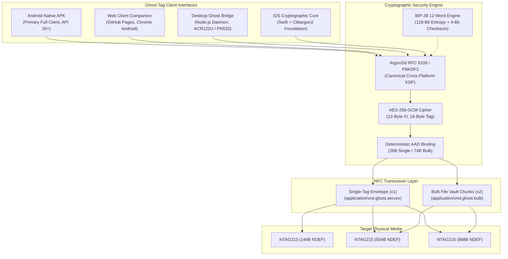
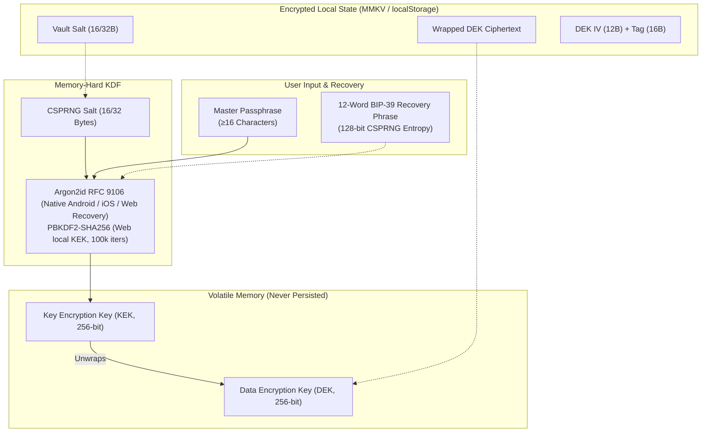
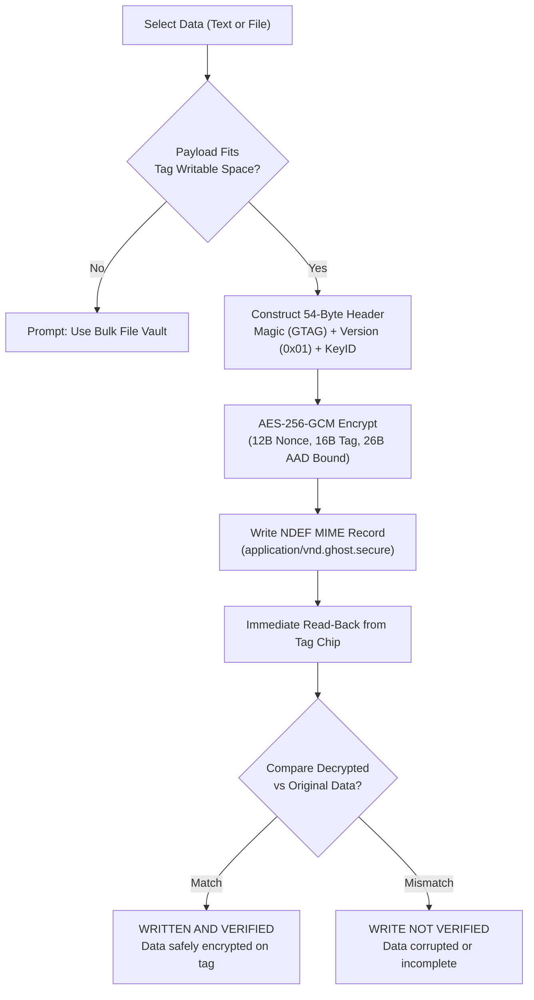
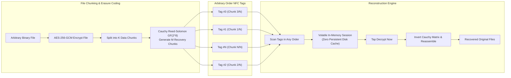
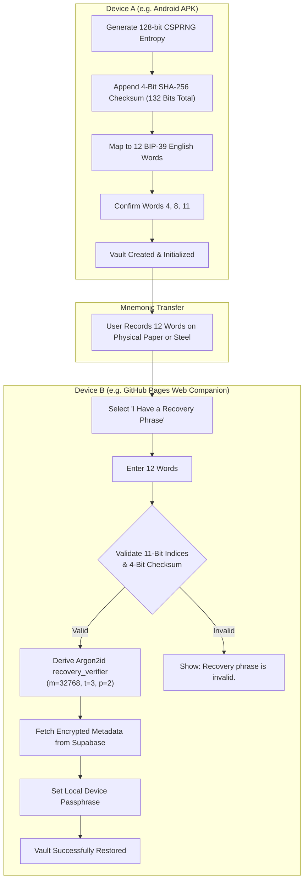

# Ghost-Tag

```
   ██████╗ ██╗  ██╗ ██████╗ ███████╗████████╗   ████████╗ █████╗  ██████╗ 
  ██╔════╝ ██║  ██║██╔═══██╗██╔════╝╚══██╔══╝   ╚══██╔══╝██╔══██╗██╔════╝ 
  ██║  ███╗███████║██║   ██║███████╗   ██║         ██║   ███████║██║  ███╗
  ██║   ██║██╔══██║██║   ██║╚════██║   ██║         ██║   ██╔══██║██║   ██║
  ╚██████╔╝██║  ██║╚██████╔╝███████║   ██║         ██║   ██║  ██║╚██████╔╝
   ╚═════╝ ╚═╝  ╚═╝ ╚═════╝ ╚══════╝   ╚═╝         ╚═╝   ╚═╝  ╚═╝ ╚═════╝ 
```

> **Encrypted NFC storage. Write. Scan. Decrypt.**
> Offline-first, cross-platform encrypted NFC vault writing authenticated AES-256-GCM ciphertext envelopes to physical NDEF tags, backed by a 12-word BIP-39 recovery hierarchy.

---

[](./LICENSE)
[-black.svg)](https://developer.android.com)
[](https://frosty-mug.github.io/Ghost-Tag/)
[](./docs/CANONICAL-SPECIFICATION.md)
[-brightgreen.svg)](./docs/testing.md)
[](./tsconfig.json)
[](https://github.com/FROSTY-MUG/Ghost-Tag)
[](https://github.com/FROSTY-MUG/Ghost-Tag/releases/tag/v2.0.6)

> [!IMPORTANT]
> **Release Status**: Ghost-Tag v2.1.0 is an unreleased local staging version.

---

### Authoritative Documentation & Quick Links
- **[Canonical Technical Specification](./docs/CANONICAL-SPECIFICATION.md)** — **Single authoritative specification** for envelopes, AAD, KDF derivations, recovery verifier, and wire formats.
- **[Launch Web Companion](https://frosty-mug.github.io/Ghost-Tag/)** — Client-side encrypted NFC app deployed on GitHub Pages.
- **[Download Android APK (v2.0.6)](https://github.com/FROSTY-MUG/Ghost-Tag/releases/tag/v2.0.6)** — Primary native client (`Ghost-Tag-v2.0.6.apk`, SHA-256 verified).
- **[Security Policy & Boundaries](./SECURITY.md)** — Vulnerability reporting SLA, zero-secrets policy, and explicit threat model boundaries.
- **[Cross-Platform Cryptographic Audit](./docs/security-audit.md)** — In-depth verification report across Android, Web, Desktop Ghost Bridge, and iOS.

---

## 1. Project Thesis

### 1.1 The Core Problem
Ordinary NFC tags are physical, ubiquitous, and convenient—but fundamentally insecure by default:
- Anyone with an NFC-enabled smartphone can read their contents in plaintext.
- Standard NDEF formatting commands zero out only table-of-contents records, leaving data remanence in EEPROM pages.
- Losing an NFC tag carrying sensitive recovery seed phrases, Wi-Fi credentials, or private files exposes plaintext to any finder.

### 1.2 Ghost-Tag's Solution
Ghost-Tag provides **data confidentiality and cryptographic tamper-evidence** for payloads stored on physical NFC chips:
> **The physical NFC tag may be inspected, duplicated, erased, or lost—yet its protected payload remains computationally unusable without the user's master passphrase and cryptographic key material.**

### 1.3 What Ghost-Tag IS NOT
- **Not a Proxmark3 or Flipper Zero replacement**: Ghost-Tag does not clone chips, perform raw RF sniffing, or bypass proprietary chip auth.
- **Not a centralized cloud vault or key escrow**: Ghost-Tag is local-first and offline-by-default. All cryptographic operations and NFC read/write workflows execute strictly on the client without remote dependencies. An optional, zero-knowledge Supabase cloud sync mode exists purely for encrypted vault metadata backup—it never receives or stores passphrases, recovery phrases, encryption keys, or NFC data.
- **Not an anti-cloning token**: If an attacker copies an NFC tag byte-for-byte, they duplicate the ciphertext; they still cannot decrypt it without the key hierarchy.
- **Hardware Support Notice**: Desktop USB reader (ACR122U) and PN532 serial drivers are implemented in source; hardware testing is actively ongoing.

---

## 2. System Architecture

Ghost-Tag operates across client interfaces sharing a unified binary envelope and key recovery format:



---

## 3. Cryptographic Key Hierarchy

Ghost-Tag enforces an ephemeral two-tier key hierarchy where master keys are never stored in plaintext on disk:



---

## 4. NFC Write Flow & Read-Back Verification

Every NFC write transaction executes cryptographic encapsulation followed by immediate read-back verification:



---

## 5. Bulk File Vault & Multi-Tag Reconstruction

Arbitrary files (images, PDFs, ZIPs, videos) are split across multiple NFC chips. Tags can be scanned in any order during recovery:



---

## 6. Cross-Platform Recovery Workflow

Vaults initialized on Android can be seamlessly recovered on the Web Companion (and vice versa) using the 12-word mnemonic:



---

## 7. Cross-Platform Compatibility Matrix

| Feature / Capability | Android APK (Primary) | Web Companion (Chrome Android) | Desktop Ghost Bridge | iOS Foundation |
| :--- | :---: | :---: | :---: | :---: |
| **NDEF Reading** | Yes (Native)* | Yes (Web NFC)* | Yes (ACR122U / PN532)* | CoreNFC Code Only* |
| **NDEF Writing** | Yes (Native)* | Yes (Web NFC)* | Yes (ACR122U / PN532)* | No (Strictly Read-Only) |
| **AES-256-GCM Encryption** | Yes (256-bit) | Yes (WebCrypto) | Yes (Node.js Crypto) | Yes (CryptoKit) |
| **BIP-39 12-Word Recovery** | Yes (Canonical) | Yes (Canonical) | Yes (Canonical) | Yes (Canonical) |
| **Single-Tag Vault (v1)** | Yes (54B Overhead) | Yes (54B Overhead) | Yes (54B Overhead) | Model Implemented |
| **Bulk Multi-Tag Vault (v2)**| Yes (134B Overhead) | Yes (134B Overhead) | Yes (134B Overhead) | Model Implemented |
| **Scanned Chunk Cache** | Volatile RAM Only | Volatile RAM Only | Volatile RAM Only | N/A |

> \* **Hardware & Cloud Status Disclosure**:
> - **Release Status**: Ghost-Tag v2.1.0 is an unreleased local staging version.
> - **iOS**: Ghost-Tag on iOS does not currently implement NFC tag writing. Its CoreNFC integration is read-only. iOS tag-writing support, if added in the future, would require separate implementation, entitlement review, compatibility testing, and physical-device validation.
> - **Supabase Cloud**: Supabase Cloud: Undeployed. Schema and atomic migration RPC are implemented and covered by local tests, but have not been deployed to a live Supabase project or validated against a live database.
> - **Hardware Validation**: Android NFC, iOS CoreNFC, Ghost Bridge ACR122U, and PN532 transceivers are implemented in source code and verified via unit tests; real-device physical execution remains unverified pending attached hardware.
> - **Pull Requests**: PR #24 and PR #25 remain open and unmerged.

| **Stop & Pause Controls** | Yes | Yes | Yes | N/A |
| **Opt-in Cloud Metadata** | Optional | Optional | Optional | Client Implemented |

---

## 8. Physical NFC Tag Capacity Invariants

| IC Type | Total EEPROM | Usable NDEF Space | v1 Overhead | v1 Max Payload | v2 Overhead | v2 Max Payload |
| :--- | :--- | :--- | :---: | :---: | :---: | :---: |
| **NTAG213** | 180 Bytes | 144 Bytes | 54 Bytes | **~90 Bytes** | 134 Bytes | **~10 Bytes** |
| **NTAG215** | 540 Bytes | 504 Bytes | 54 Bytes | **~450 Bytes** | 134 Bytes | **~370 Bytes** |
| **NTAG216** | 924 Bytes | 888 Bytes | 54 Bytes | **~834 Bytes** | 134 Bytes | **~754 Bytes** |

---

## 9. Verification & Quality Gates

Ghost-Tag maintains a 100% test passing rate across all cryptographic and integration suites:

```bash
# Run unit & integration tests (258 passing tests on main)
npm test

# Static type verification (0 errors in strict mode)
npx tsc --noEmit

# Run automated security invariants audit
python scripts/security_audit_agent.py
```

---

## 10. Repository Architecture

```
Ghost-Tag/
├── android/               # Android APK native codebase (Gradle, NDK C++, JNI)
├── desktop/               # Desktop Ghost Bridge daemon (PC/SC, APDU, PN532 UART/I2C)
├── ios/                   # iOS Swift core, Clibargon2 C library, and XCTest suite
├── web/                   # Client-side web companion deployed to GitHub Pages
├── supabase/              # Supabase migrations and zero-knowledge edge functions
├── test-fixtures/         # Golden reference vectors (crypto, envelopes, recovery)
├── src/                   # React Native & TypeScript cross-platform domain core
│   ├── contracts/         # Canonical schemas, enums, errors, and hardware limits
│   ├── crypto/            # AES-256-GCM, Argon2id, envelope codec, Cauchy RS
│   ├── operations/        # Orchestrators for scan, write, bulk, and reconstruction
│   ├── security/          # In-memory zeroization, anti-leak, and device integrity
│   └── vault/             # Local vault managers, DEK rotation, and RAM chunk cache
├── docs/                  # Technical documentation suite
│   ├── CANONICAL-SPECIFICATION.md # Single authoritative source of truth
│   ├── security-audit.md  # Comprehensive security audit report
│   ├── recovery.md        # BIP-39 12-word recovery guide
│   └── architecture.md    # Subsystem decomposition guide
├── CHANGELOG.md           # Keep a Changelog compliant history
├── LICENSE                # MIT License
├── README.md              # Project thesis and technical specifications
└── SECURITY.md            # Vulnerability disclosure policy and boundaries
```

---

## License

Ghost-Tag is licensed under the [MIT License](./LICENSE).
