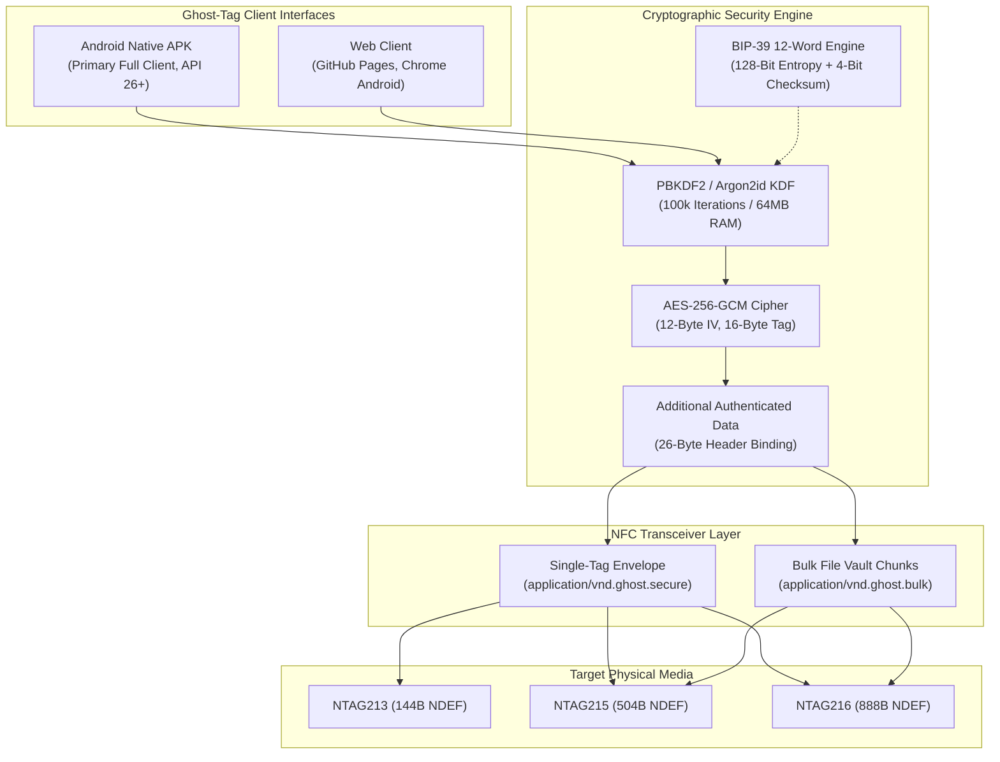
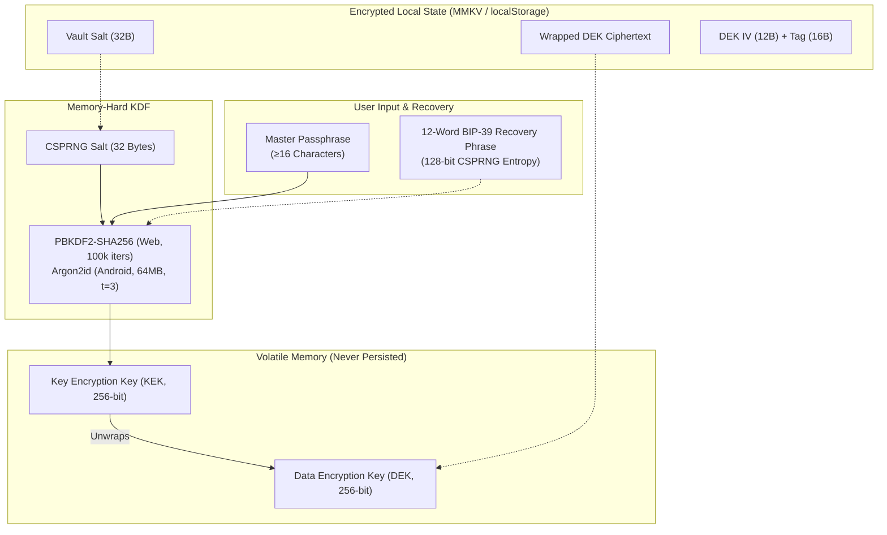
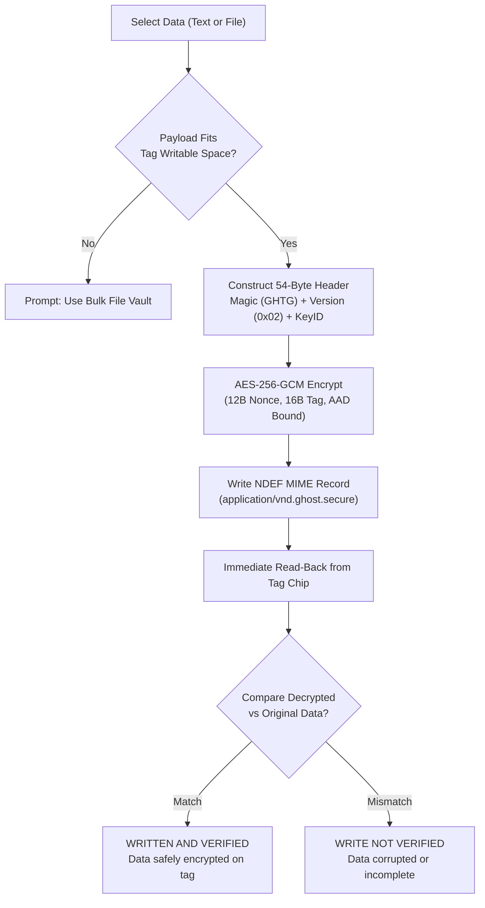
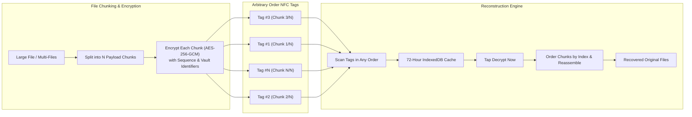
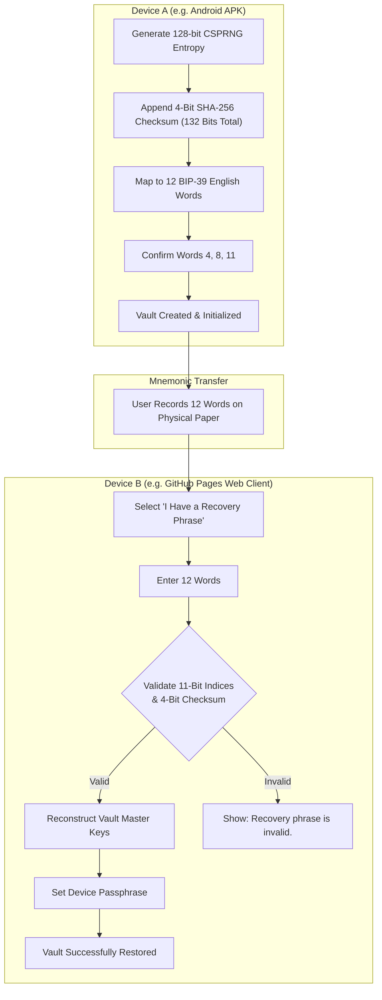
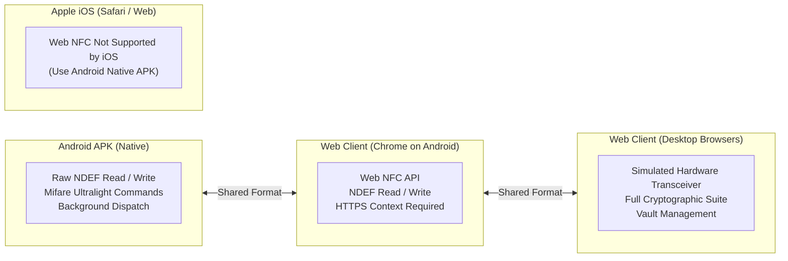

# Ghost-Tag

```
   ██████╗ ██╗  ██╗ ██████╗ ███████╗████████╗   ████████╗ █████╗  ██████╗ 
  ██╔════╝ ██║  ██║██╔═══██╗██╔════╝╚══██╔══╝   ╚══██╔══╝██╔══██╗██╔════╝ 
  ██║  ███╗███████║██║   ██║███████╗   ██║         ██║   ███████║██║  ███╗
  ██║   ██║██╔══██║██║   ██║╚════██║   ██║         ██║   ██╔══██║██║   ██║
  ╚██████╔╝██║  ██║╚██████╔╝███████║   ██║         ██║   ██║  ██║╚██████╔╝
   ╚═════╝ ╚═╝  ╚═╝ ╚═════╝ ╚══════╝   ╚═╝         ╚═╝   ╚═╝  ╚═╝ ╚═════╝ 
```

> **Encrypted NFC storage. Write. Scan. Decrypt.**
> Offline-first, cross-platform encrypted NFC vault writing authenticated AES-256-GCM ciphertext envelopes to physical NDEF tags, backed by a 12-word BIP-39 recovery hierarchy.

---

[](./LICENSE)
[-black.svg)](https://developer.android.com)
[](https://frosty-mug.github.io/Ghost-Tag/)
[](./docs/security.md)
[-brightgreen.svg)](./docs/testing.md)
[](./tsconfig.json)
[](https://github.com/FROSTY-MUG/Ghost-Tag/releases/tag/v2.0.5)

---

### Quick Links
- **[Launch Web Client](https://frosty-mug.github.io/Ghost-Tag/)** — Minimal client-side encrypted NFC app on GitHub Pages.
- **[Download Android APK (v2.0.5)](https://github.com/FROSTY-MUG/Ghost-Tag/releases/tag/v2.0.5)** — Primary native client (`Ghost-Tag-v2.0.5.apk`, SHA-256 verified).
- **[NDEF Envelope Specification](./docs/nfc-format.md)** — Canonical binary envelope layout.
- **[Security Architecture](./docs/security.md)** — Zero-secrets policy and cryptographic threat boundaries.

---

## 1. Project Thesis

### 1.1 The Core Problem
Ordinary NFC tags are physical, ubiquitous, and convenient—but fundamentally insecure by default:
- Anyone with an NFC-enabled smartphone can read their contents in plaintext.
- Standard NDEF formatting commands zero out only table-of-contents records, leaving data remanence in EEPROM pages.
- Losing an NFC tag carrying sensitive recovery seed phrases, Wi-Fi credentials, or private files exposes plaintext to any finder.

### 1.2 Ghost-Tag's Solution
Ghost-Tag provides **data confidentiality and cryptographic tamper-evidence** for payloads stored on physical NFC chips:
> **The physical NFC tag may be inspected, duplicated, erased, or lost—yet its protected payload remains computationally unusable without the user's master passphrase and cryptographic key material.**

### 1.3 What Ghost-Tag IS NOT
- **Not a Proxmark3 or Flipper Zero replacement**: Ghost-Tag does not clone chips, perform raw RF sniffing, or bypass proprietary chip auth.
- **Not a PKI or cloud vault**: Ghost-Tag is completely offline. It never communicates with remote servers or cloud backends.
- **Not an anti-cloning token**: If an attacker copies an NFC tag byte-for-byte, they duplicate the ciphertext; they still cannot decrypt it without the key hierarchy.

---

## 2. System Architecture

Ghost-Tag operates across two decoupled clients sharing a unified binary envelope and key recovery format:



---

## 3. Cryptographic Key Hierarchy

Ghost-Tag enforces an ephemeral two-tier key hierarchy where master keys are never stored in plaintext on disk:



---

## 4. NFC Write Flow & Read-Back Verification

Every NFC write transaction executes cryptographic encapsulation followed by immediate read-back verification:



---

## 5. Bulk File Vault & Multi-Tag Reconstruction

Large files (images, PDFs, ZIPs, videos) are split across multiple NFC chips. Tags can be scanned in any order during recovery:



---

## 6. Cross-Platform Recovery Workflow

Vaults initialized on Android can be seamlessly recovered on the Web Client (and vice versa) using the 12-word mnemonic:



---

## 7. Cross-Platform Compatibility Matrix



### Detailed Capability Matrix:

| Feature / Capability | Android APK (v2.0.5) | Web Client (Chrome Android) | Web Client (iOS Web) | Web Client (Desktop) |
| :--- | :---: | :---: | :---: | :---: |
| **NDEF Record Reading** | Yes (Native) | Yes (Web NFC) | No (OS Limitation) | Simulated |
| **NDEF Record Writing** | Yes (Native) | Yes (Web NFC) | No (OS Limitation) | Simulated |
| **AES-256-GCM Encryption** | Yes (256-bit) | Yes (WebCrypto) | Yes (WebCrypto) | Yes (WebCrypto) |
| **BIP-39 12-Word Recovery** | Yes | Yes | Yes | Yes |
| **Single-Tag Vault** | Yes | Yes | Read-only with native app | Simulated |
| **Bulk Multi-Tag Vault** | Yes | Yes | Read-only with native app | Simulated |
| **72-Hour Cache Engine** | Yes (MMKV) | Yes (IndexedDB) | Yes (IndexedDB) | Yes (IndexedDB) |
| **Stop & Pause Controls** | Yes | Yes | Yes | Yes |
| **Zero Network Permissions** | Enforced | Enforced | Enforced | Enforced |

---

## 8. Physical NFC Tag Specifications

Ghost-Tag automatically detects tag geometry and computes usable Ghost storage:

| IC Type | Total EEPROM | Usable NDEF Space | Header Overhead | Max Usable Ghost Storage |
| :--- | :--- | :--- | :--- | :--- |
| **NTAG213** | 180 Bytes | 144 Bytes | 54 Bytes | **90 Bytes** |
| **NTAG215** | 540 Bytes | 504 Bytes | 54 Bytes | **450 Bytes** |
| **NTAG216** | 924 Bytes | 888 Bytes | 54 Bytes | **834 Bytes** |

---

## 9. Verification & Quality Gates

Ghost-Tag maintains 100% test passing rates across all cryptographic and hardware simulation suites:

```bash
# Run unit & integration tests (130 passing)
npm test

# Static type verification (0 errors)
npx tsc --noEmit
```

---

## 10. Repository Architecture

```
Ghost-Tag/
├── android/               # Android APK native codebase (Gradle, NDK, JNI)
│   ├── app/               # Native application module
│   └── README.md          # Android build and architecture guide
├── web/                   # Client-side web client (GitHub Pages)
│   ├── index.html         # Minimal brutalist landing & vault UI
│   ├── app.js             # Web NFC transceiver, cache, and crypto engine
│   ├── styles.css         # Apple-inspired brutalist dark styling
│   ├── wordlist.js        # BIP-39 2,048 English wordlist
│   ├── assets/            # Subtle blurred visual assets
│   ├── package.json       # Web client package descriptor
│   └── README.md          # Web client documentation
├── docs/                  # Technical documentation suite
│   ├── nfc-format.md      # Canonical NDEF binary envelope layout
│   ├── security.md        # Cryptographic security & threat boundaries
│   ├── recovery.md        # BIP-39 12-word recovery specification
│   ├── testing.md         # Test verification & test vectors
│   └── architecture.md    # System design documentation
├── .github/               # GitHub issue templates, rulesets, and configs
│   ├── ISSUE_TEMPLATE/    # Bug report, feature request, nfc-compat, docs
│   └── FUNDING.yml        # Sponsorship configuration
├── CHANGELOG.md           # Keep a Changelog compliant release history
├── LICENSE                # MIT License
├── README.md              # Project thesis and technical specifications
└── SECURITY.md            # Vulnerability reporting and security policy
```

---

## License

Ghost-Tag is licensed under the [MIT License](./LICENSE).
