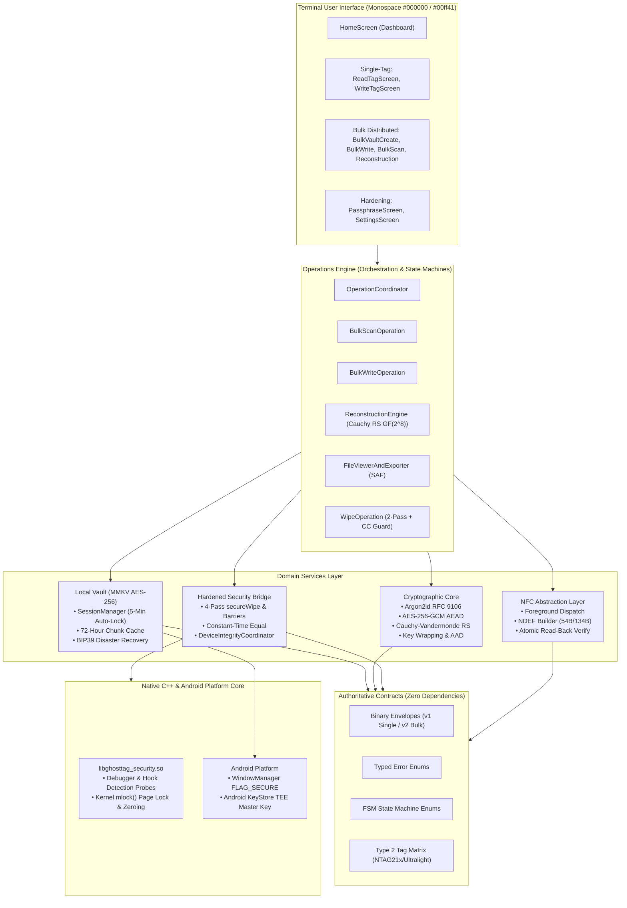
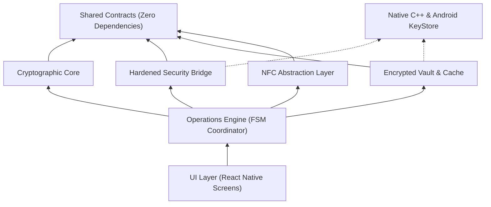

# Ghost-Tag System Architecture

Ghost-Tag is architectured around decoupled, single-responsibility subsystems communicating through strictly-typed contracts, reinforced by a native multi-language security core.

---

## 1. High-Level Subsystem Decomposition

---

## 2. Detailed Subsystem Breakdown

### 2.1 Shared Contracts (`src/contracts/`)
Defines authoritative schemas, error codes, and hardware invariants:
- **`envelope.ts`**: 54-byte single-payload envelope constants, field offsets, and AAD calculation.
- **`bulkEnvelope.ts`**: 134-byte bulk chunk envelope wire format, 74-byte AAD specification.
- **`bulkVault.ts`**: Multi-file manifest, private tag mapping, chunk cache, and journal schemas.
- **`errors.ts`**: Canonical error registry, severity tiers, and `GhostTagError` hierarchy.
- **`keyHierarchy.ts`**: KEK, DEK, WrappedDEK, and device-tier calibrated KDF parameters.
- **`recovery.ts`**: 24-word BIP39 mnemonic configurations and recovery envelope schemas.
- **`tags.ts`**: Supported Type 2 Tag hardware matrix, page memory layouts, and exclusion rules.
- **`states.ts`**: Deterministic finite state machines for Scan, Write, Bulk, and Wipe operations.

### 2.2 Cryptographic Core (`src/crypto/`)
Zero-dependency, audited cryptographic implementations:
- **`random.ts`**: High-entropy CSPRNG accessing OS entropy via `react-native-quick-crypto`.
- **`argon2.ts`**: RFC 9106 Argon2id key derivation, device benchmarking, downgrade detection.
- **`aesGcm.ts`**: AES-256-GCM authenticated encryption/decryption with constant-time verification.
- **`erasureCoding.ts`**: Cauchy-Vandermonde Reed-Solomon over $\text{GF}(2^8)$ for lost tag tolerance.
- **`fileEncryption.ts`**: Arbitrary opaque file encryption, chunk slicing, and full-file reassembly.
- **`envelope.ts`**: v1 Little-Endian 54-byte binary envelope codec.
- **`bulkEnvelope.ts`**: v2 Little-Endian 134-byte chunk binary envelope codec with SHA-256 integrity.
- **`keyWrap.ts`**: NIST SP 800-38D AES-GCM key wrapping with 19-byte domain separation AAD.
- **`secureMemory.ts`**: In-place buffer sanitization re-exported from `src/security/`.

### 2.3 Hardened Security & Anti-Leak (`src/security/`)
Application-level integrity enforcement and memory protection:
- **`deviceIntegrity.ts`**: Fail-closed integrity gate verifying debugger, hooking, and root status.
- **`secureWipe.ts`**: 4-pass memory overwrite (`0xAA`, `0x55`, CSPRNG, `0x00`) with recursive object wiping.
- **`antiLeak.ts`**: Constant-time byte comparison (`timingSafeEqual`), secret redaction filter for logs, and sanitized logging proxies.

### 2.4 Native C++ Security Engine (`android/app/src/main/cpp/`)
Direct Linux kernel inspections compiled to ARM64/x86_64 machine code (`libghosttag_security.so`):
> **Explicit Security Boundary**: Ghost-Tag cannot protect data on a compromised or unlocked device. Client-side controls do not prevent reverse engineering.
- **`security_core.cpp`**:
  - Environment Inspection: Basic attachment probe, `/proc/self/status` `TracerPid` inspection, `/proc/self/wchan` monitoring.
  - Runtime Integrity Inspection: `/proc/self/maps` scanner checking for instrumentation libraries and root binaries.
- **`secure_memory.cpp`**:
  - Memory page locking via `mlock()` to prevent kernel swap or flash storage persistence.
  - Non-optimizable volatile zeroization with `asm volatile("" : : "r"(addr) : "memory")` compiler clobber barriers.
- **`jni_bridge.cpp`**: JNI exports bridging C++ functions to Android Kotlin runtime.

### 2.5 Android Platform Gateway (`android/app/src/main/java/com/ghosttag/`)
- **`MainActivity.kt`**: Enforces `WindowManager.LayoutParams.FLAG_SECURE` in `onCreate()` and `onResume()`, preventing screenshots, screen recordings, and recent-app previews.
- **`KeyStoreMasterKey.kt`**: Encapsulates local database keys inside Android KeyStore hardware (TEE / StrongBox) using AES-256-GCM.
- **`SecurityBridgeModule.kt`**: React Native native module exposing native security status checks.
- **`network_security_config.xml`**: Rejects all cleartext HTTP traffic across all domains.
- **`proguard-rules.pro`**: Aggressive R8 rules collapsing namespaces (`com.ghosttag.obf`), stripping symbols, and removing debug logging calls.

### 2.6 Local Vault & Chunk Cache (`src/vault/`)
- **`database.ts`**: AES-256 encrypted key-value storage adapter via `react-native-mmkv`.
- **`vaultManager.ts`**: Single-payload vault lifecycle coordinator (setup, open, lock, rotate).
- **`bulkVaultManager.ts`**: Multi-file vault manager, private tag mappings, and file addition pipeline.
- **`session.ts`**: Ephemeral in-memory KEK lifecycle with 5-minute auto-lock and background wiping.
- **`chunkCache.ts`**: 72-hour temporary encrypted chunk cache with TTL countdown and auto-purge.
- **`journalManager.ts`**: Crash-resilient write and scan transaction journals.
- **`dekManager.ts`**: Generates, stores, and rotates wrapped 256-bit Data Encryption Keys.
- **`recoveryManager.ts`**: 24-word BIP39 mnemonic generation, derivation, and disaster recovery.
- **`manifest.ts`**: HMAC-SHA-256 tamper-evident integrity protection for vault metadata.
- **`auditLog.ts`**: Rolling SHA-256 hash-chained append-only audit log.

### 2.7 NFC Abstraction Layer (`src/nfc/`)
- **`nfcManager.ts`**: Android foreground dispatch lifecycle and NFC controller state monitoring.
- **`tagReader.ts`**: NDEF discovery and binary envelope extraction.
- **`tagWriter.ts`**: Atomic NDEF write pipeline with mandatory read-back verification.
- **`tagInfo.ts`**: Tag family identification, lock-byte inspection, and usable capacity calculation.
- **`tagWiper.ts`**: Destructive page-by-page overwrite engine with CC protection.
- **`ndefBuilder.ts`**: Single-envelope NDEF record builder (`application/vnd.ghost.secure`).
- **`bulkNdefBuilder.ts`**: Bulk chunk NDEF record builder (`application/vnd.ghost.bulk`).
- **`errors.ts`**: Native Android NFC error translation into typed GhostTag error codes.

### 2.8 Operations Engine (`src/operations/`)
Finite state machines orchestrating multi-step cryptographic and RF operations:
- **`scanOperation.ts`**: Single-tag detection, envelope extraction, DEK unwrap, and decryption.
- **`writeOperation.ts`**: Capacity validation, DEK generation, encryption, write, and verify.
- **`bulkWriteOperation.ts`**: Multi-tag sequential write, chunk tracking, and extra-tag exclusion.
- **`bulkScanOperation.ts`**: Random-order tag scanning, duplicate rejection, and cache aggregation.
- **`reconstructionEngine.ts`**: Cauchy RS decode, ciphertext concatenation, and SHA-256 validation.
- **`fileViewerAndExporter.ts`**: Storage Access Framework (SAF) export and disposable zeroization.
- **`wipeOperation.ts`**: Multi-pass user-memory overwrite with honesty checks.
- **`verifyOperation.ts`**: Passive envelope validation without decrypting plaintext.
- **`repairOperation.ts`**: Re-encryption and key rotation workflow.
- **`diagnosticsExporter.ts`**: Sanitized audit and system diagnostics export.
- **`operationCoordinator.ts`**: High-level unified facade connecting UI screens to subsystems.

### 2.9 Terminal User Interface (`src/ui/`)
- Black `#000000` high-contrast background with green `#00ff41` monospace typography.
- Status streams with bracketed tags (`[SCAN]`, `[PARSE]`, `[KEY]`, `[RECON]`, `[ERROR]`).
- Instantaneous user feedback with zero decorative animation delays.
- Screens: `HomeScreen`, `BulkVaultCreationScreen`, `BulkWriteScreen`, `BulkScanScreen`, `ReconstructionScreen`.

---

## 3. Unidirectional Dependency Architecture

To prevent tight coupling, spaghetti logic, and circular dependencies, Ghost-Tag enforces a strict hierarchical dependency graph:

- **Contracts** (`src/contracts/`) never import from any other module.
- **Crypto**, **Security**, **Vault**, and **NFC** import solely from **Contracts**.
- **Operations** orchestrates domain modules and reports state transitions.
- **UI** consumes **Operations** and renders state; it never calls crypto or raw NFC directly.
