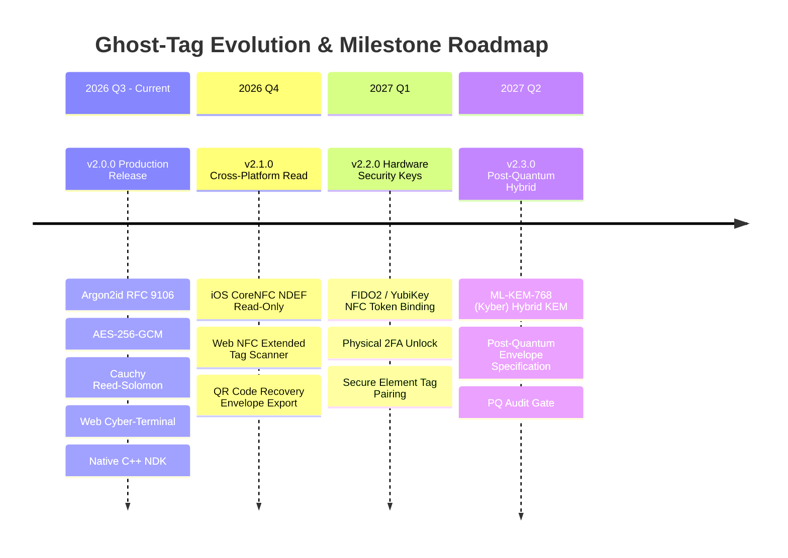

# Ghost-Tag Product & Architectural Roadmap

This document outlines the strategic engineering roadmap for Ghost-Tag across upcoming release cycles.

---

---

## 1. Version 2.0.0 — Production Baseline (Current)
- [x] Multi-tag distributed bulk vault with chunk sharding.
- [x] Cauchy Reed-Solomon $K$-of-$N$ erasure coding for parity recovery.
- [x] RFC 9106 Argon2id memory-hard key derivation.
- [x] 24-word BIP39 emergency recovery phrase derivation.
- [x] JNI Native C++ NDK module for memory zeroization and constant-time equality checks.
- [x] Responsive brutalist cyber-terminal web simulation deployed to GitHub Pages.

---

## 2. Version 2.1.0 — Platform Parity & CoreNFC Read
- [ ] **iOS CoreNFC Integration**:
  - Implement read-only NDEF scanning using Apple `CoreNFC` framework.
  - Decrypt single-tag and bulk envelopes on iOS devices.
- [ ] **Web NFC Chrome Enhancement**:
  - Expand Web NFC simulator to support physical tag reading in Chrome on Android over HTTPS.
- [ ] **QR-Envelope Backup**:
  - Optional visual air-gapped backup encoding small encrypted vaults into printable QR sheets.

---

## 3. Version 2.2.0 — Hardware Security Module & FIDO2 Binding
- [ ] **YubiKey / Security Token NFC Challenge-Response**:
  - Derive secondary encryption entropy from physical NFC security keys using HMAC-SHA1 challenge-response.
  - Requires physical security key tap before vault unlock.
- [ ] **Android StrongBox Keymaster Integration**:
  - Wrap KEK using hardware-backed Secure Element (Titan M / Knox StrongBox) when available.

---

## 4. Version 2.3.0 — Post-Quantum Hybrid Cryptography
- [ ] **Hybrid KEM (ML-KEM-768 + X25519)**:
  - Transition canonical envelope to hybrid quantum-resistant key encapsulation.
  - Protects archival physical tags against future "store now, decrypt later" quantum attacks.
