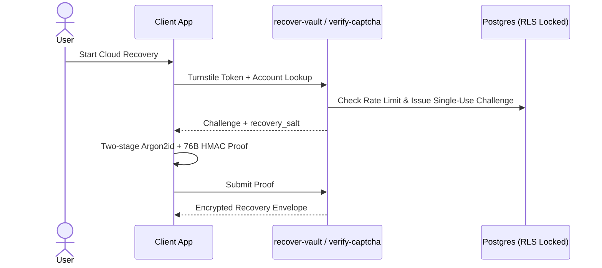

# Cloud Recovery

> **Deployment Status**: Staged in `supabase/` and verified under mocked Jest security suites; **not yet deployed to live hosted Supabase**.

Cloud recovery is an **optional** internet-dependent workflow for restoring encrypted vault metadata across devices without transmitting plaintext secrets or user passphrases.

## `v2.1.0` Challenge/Proof Flow
1. **Turnstile Verification**: Client obtains a Cloudflare Turnstile token verified fail-closed by `verify-captcha` ([supabase/functions/_shared/turnstile.ts](../../supabase/functions/_shared/turnstile.ts)).
2. **Challenge Issuance**: `recover-vault` issues a single-use challenge tied to the account's server-generated 32-byte `recovery_salt` (`20261126_v210_account_security_schema.sql`).
3. **76-Byte HMAC Proof**: Client computes proof locally using the two-stage Argon2id recovery verifier and submits it to `recover-vault` ([supabase/functions/_shared/recoverVaultHandler.ts](../../supabase/functions/_shared/recoverVaultHandler.ts)).
4. **Anti-Enumeration**: Constant-time response shaping with `SERVER_ENUMERATION_SECRET` prevents account probing.

## Canonical Sources
- [Supabase-Backend.md](Supabase-Backend.md)
- [Recovery.md](Recovery.md)
- [src/__tests__/supabaseSync.test.ts](../../src/__tests__/supabaseSync.test.ts)
