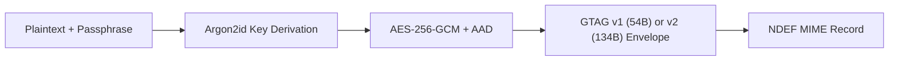

# Encryption

All Ghost-Tag payloads are encrypted **client-side** before touching an NFC tag or optional cloud metadata store.

## Primitives
- **KDF**: Argon2id (`t=4` iterations, `m=65536` KiB / `64 MiB` canonical mobile/desktop tier; `16 MiB` / `32 MiB` / `64 MiB` configurable tiers in [src/crypto/argon2.ts](../../src/crypto/argon2.ts)).
- **Cipher**: AES-256-GCM with 12-byte CSPRNG IV and 16-byte authentication tag ([src/crypto/fileEncryption.ts](../../src/crypto/fileEncryption.ts)).
- **Envelope Overhead**:
  - **Ghost v1** (single-tag): `54` bytes fixed overhead (`26B` AAD).
  - **Ghost v2** (bulk multi-tag): `134` bytes fixed overhead (`74B` AAD + `32B` SHA-256 `CHUNK_HASH`).

## Canonical Sources
- [docs/cryptography.md](../cryptography.md)
- [docs/envelope-specification.md](../envelope-specification.md)
- [src/__tests__/crypto.test.ts](../../src/__tests__/crypto.test.ts)
